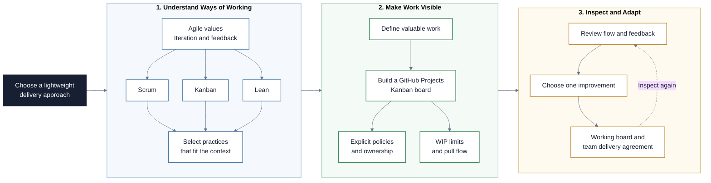

# Intro to Project Management

A practical introduction to project management concepts for AI and software
product work. You will build a shared vocabulary for Agile delivery, understand
how Scrum structures team collaboration, use Kanban to make work visible, and
connect Lean principles to value delivery and continuous improvement.

## Project at a Glance

The project turns delivery principles into a visible, adaptable way of working
for an AI or software team.



## Learning Objectives

By the end of this repository, you should be able to:

- Explain why Agile project management emphasizes iteration, feedback, and
  adaptation.
- Distinguish Scrum, Kanban, and Lean at a practical level.
- Identify Scrum accountabilities, events, artifacts, commitments, values, and
  pillars.
- Describe how Kanban boards, WIP limits, explicit policies, and flow metrics
  improve team visibility.
- Connect Lean ideas such as value, flow, pull, waste reduction, and continuous
  improvement to AI product work.
- Choose a lightweight project-management approach for a team, product, or
  learning project.

## Learning Path

| File / Folder | Description |
|---|---|
| [**01 - Agile Methodologies**](01-agile-methodologies.md) | Understand Agile values, principles, common methods, and why iterative delivery matters for digital products. |
| [**02 - Scrum**](02-scrum.md) | Learn current Scrum accountabilities, events, artifacts, commitments, values, pillars, and self-check questions. |
| [**03 - Kanban**](03-kanban.md) | Explore visual workflow management, WIP limits, explicit policies, flow metrics, and Kanban boards. |
| [**04 - Lean**](04-lean.md) | Connect Lean principles to waste reduction, continuous improvement, and product delivery. |
| [**05 - Session Handout**](05-session-handout.md) | Use GitHub Projects in groups to manage an AI assistant scenario with a Kanban board. |

### Additional Folders and Files

| File / Folder | Description |
|---|---|
| [**assets**](assets/) | Visual aids referenced in the lesson files. |

## Setup

> [!NOTE]
> Throughout these steps, text in angle brackets like `<repo-name>` is a
> **placeholder**. Replace it including the `< >` brackets with your own value.
> For example, `cd <repo-name>` becomes `cd aipm-intro-to-pm`.

### 1. Create the Repository from the Template

Click **Use this template** on GitHub.

When creating the repository:

- Set yourself as the **Owner**
- Choose a repository name
- Disable **Include all branches**
- Click **Create repository**

> [!IMPORTANT]
> If you are working in pairs or groups, only **one person** should complete
> this step.

---

### 2. Add Collaborators (Pairs/Groups Only)

If working with teammates:

1. Open the repository on GitHub
2. Go to **Settings → Collaborators**
3. Add your teammates as collaborators
4. Share the repository link with your team

Teammates should accept the invitation before continuing.

---

### 3. Clone the Repository

Copy the SSH URL from the **Code** button on GitHub, then run:

```bash
git clone <copied-ssh-url>
```

The copied SSH URL will look like:
`git@github.com:<your-username>/<repo-name>.git`.

---

### 4. Move into the Project Folder

No Python environment is required for this repository.

```bash
cd <repo-name>
```

---

### 5. Open the Lesson Files

Open `README.md` and follow the lesson files in numerical order. The files are
plain Markdown and can be read directly on GitHub or in a local editor.

## References & Further Reading

- [**Agile Manifesto**](https://agilemanifesto.org/): The foundational values
  and principles behind Agile software development.
- [**Scrum Guide**](https://scrumguides.org/scrum-guide.html): The official
  guide to Scrum events, artifacts, commitments, and accountabilities.
- [**Kanban Guide**](https://kanbanguides.org/): A concise reference for Kanban
  systems, flow, WIP limits, and service delivery.
- [**Lean Enterprise Institute: What is Lean?**](https://www.lean.org/explore-lean/what-is-lean/):
  A practical introduction to Lean thinking, value, waste reduction, and
  continuous improvement.
